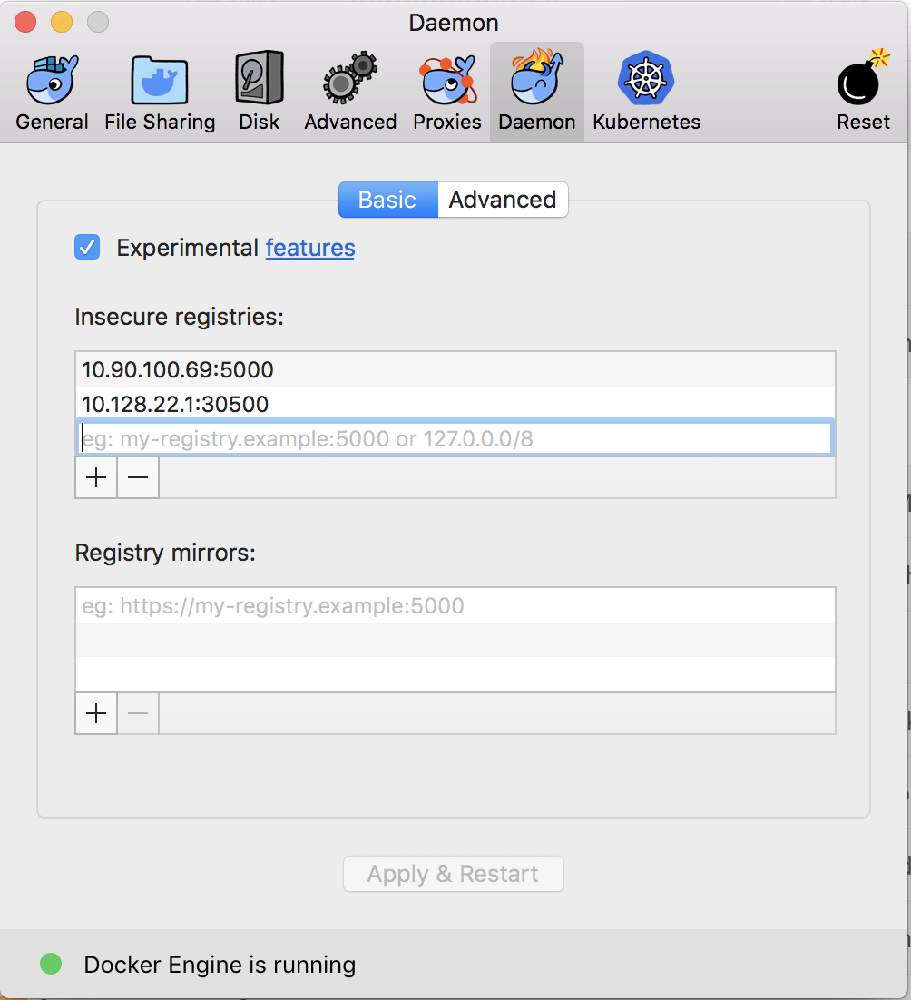

# SEBA in a Box for development

This tutorial will guide you through the development workflow for a SEBA component using
the environment provided by SEBA in a Box.

The tutorial will use the `rcord` service as an example, but the same workflow can be used
for each docker-based component in SEBA. 

If you are working on ONOS applications, you want to take a look at this [tutorial](./onos-apps.md).

> NOTE that the same workflow can be adapted for:
> - different emulated environment (eg: `MCORD in a Box`)
> - physical setups

### Requirements

In order to follow this tutorial you need to:

- have a remote machine to run [SEBA-in-a-Box](../../profiles/seba/siab.md)
- have Docker installed on your development machine (Install docker on [Mac](https://docs.docker.com/docker-for-mac/install/), [Ubuntu](https://docs.docker.com/install/linux/docker-ce/ubuntu/) or [Windows](https://docs.docker.com/docker-for-windows/install/))
- have the CORD code (we suggest to download the code using [this guide](../getting_the_code.md#download-cord-repositories)) 

## Preparing SEBA in a Box

We suggest to refer to [this](../../profiles/seba/siab.md) guide to deploy SEBA in a Box, but for simplicity
the commands are replicated here:

```bash
mkdir -p ~/cord
cd ~/cord
git clone https://gerrit.opencord.org/automation-tools
cd automation-tools/seba-in-a-box
make latest
``` 

> NOTE that for development we suggest do use the `latest` available version of all the components,
> but in certain cases (eg: bugfixes) you may want to use `make stable`

## Deploy a docker registry

In order to move Docker images from your laptop to the SEBA in a Box environment you need
a Docker registry. You can install one using `helm`:

```bash
helm install stable/docker-registry --set service.nodePort=30500,service.type=NodePort -n docker-registry
```

### Configure docker to push to an insecure registry

The registry deployed via `helm` is by default an insecure registry (it uses `http` instead of `https`)
thus `docker` requires that you explicitly authorize that registry.

You can find more informations about insecure registries on the [docker documentation](https://docs.docker.com/registry/insecure/).

#### MacOS

To open the `Docker` preferences click on the icon in the status bar (top right of the screen)
and select `preferences`.

Navigate to the `Daemon` tab and under `Insecure registries` add the `ip` and `port` of the one
running on your `SiaB` machine:



> NOTE that the docker-registry endpoint should be `myregistrydomain.com:30500`
> where `myregistrydomain.com` is the public `ip` of your `SiaB` machine.

Click on `Apply and Restart` to apply your changes.

#### Linux

> This needs to be done on the SiaB machine (and on you machine if it's a Linux based machine)

Edit the `/etc/docker/daemon.json` file and add:

```json
{
  "insecure-registries" : ["myregistrydomain.com:30500"]
}
```

where `myregistrydomain.com` is the public `ip` of your `SiaB` machine.

Then restart the docker daemon with: `sudo service docker restart`

## Make changes and publish the image

Once you make the appropriate changes to the code, you can buid it with:

```bash
cd ~/cord/orchestration/xos-services/rcord
DOCKER_REGISTRY=myregistrydomain.com:30500/ DOCKER_REPOSITORY=xosproject/ DOCKER_TAG=candidate make docker-build
...
Successfully built 14a4ec8f2906
Successfully tagged myregistrydomain.com/xosproject/rcord-synchronizer:candidate
```
where `myregistrydomain.com` is the public `ip` of your `SiaB` machine.

> **Note:** In some cases the command to build the docker image may vary. 
> Please check the Makefile within the repo for more informations.

To push the newly built image to your docker registry use this command:

```bash
cd ~/cord/orchestration/xos-services/rcord
DOCKER_REGISTRY=myregistrydomain.com:30500/ DOCKER_REPOSITORY=xosproject/ DOCKER_TAG=candidate make docker-push
docker push myregistrydomain.com:30500/xosproject/rcord-synchronizer:candidate
The push refers to repository [myregistrydomain.com:30500/xosproject/rcord-synchronizer]
43b4d40e8ced: Layer already exists
70019539cd35: Layer already exists
56585fbf0fe2: Layer already exists
4929606216d8: Layer already exists
343eab13e1e3: Layer already exists
ea7c8d4e60dc: Layer already exists
7d63eb9a32c4: Layer already exists
bcf2f368fe23: Layer already exists
candidate: digest: sha256:f5ecac2ba76c2a81a6f8b82b09e07c53f9ca2f3d272c8861ed7f5ed1ac290ac8 size: 1993
```

where `myregistrydomain.com` is the public `ip` of your `SiaB` machine.

## Customizing the installation

When `SiaB` is installed with the `make latest` command, a [`values.yaml`](https://github.com/opencord/helm-charts/blob/master/configs/seba-ponsim-latest.yaml) file is applied
to all the `helm install` commands.

> To know more about `values` files, please check the official [helm documentation](https://helm.sh/docs/chart_template_guide/#values-files)

To customize the installation, download the default `seba-ponsim-latest.yaml` so that you can customize it:

```bash
curl https://raw.githubusercontent.com/opencord/helm-charts/master/configs/seba-ponsim-latest.yaml -o ~/custom.yaml
```

### Update the helm chart

To deploy the new container you need to update the helm-chart, but first you need to customize the
value file.

Open the file you downloaded in `~/custom.yaml` and change the `rcord` section so that it looks like:

```yaml
rcord:
  image:
    repository: "myregistrydomain.com:30500/xosproject/rcord-synchronizer"
    tag: 'candidate'
```

The `rcord` service is installed by the `seba-services` helm chart, so you need to upgrade it to
the new version:

```bash
cd ~/cord/helm-charts
helm upgrade --install seba-services xos-profiles/seba-services -f ~/custom.yaml
```

> NOTE it's important that you upgrade the chart defining the component you are developing.
> For more informations about the helm charts visit the [Helm reference](../../charts/helm.md) section in the guide.

### Reinstall from scratch

In some cases you want to restart from a clean environment using your images.
If you do that it is important not to run the `make reset-kubeadm` command as that will
completely teardown kubernetes, deleting the docker registry.

To remove all the installed containers you can instead use the `make teardown-charts` commands.

Once all the containers have been removed, you can reinstall everything using your value file with:

```bash
SEBAVALUES=~/custom.yaml make
```

> NOTE that the `latest` target is not needed as we are specifying a custom value file through the `SEBAVALUES` variable.

## Troubleshooting

If you are facing issues with this development workflow, please report your problem on the [SEBA-dev](https://groups.google.com/a/opennetworking.org/forum/#!forum/seba-dev)
or [CORD-dev](https://groups.google.com/a/opencord.org/forum/#!forum/cord-dev) mailing lists, or contact `@teone` on slack.

## FAQs

#### I don't want to use a private docker-registry, can I use Docker Hub?

If you don't want to deploy a docker-registry on the POD, you can use any docker registry.
The `docker-build/docker-push` commands are flexible enough to accomodate that,
for example you can build and push the container with these commands:

```bash
DOCKER_REPOSITORY=matteoscandolo/ DOCKER_TAG=candidate make docker-build
DOCKER_REPOSITORY=matteoscandolo/ DOCKER_TAG=candidate make docker-push
```

And customize your value file to fetch that image:

```yaml
rcord:
  image:
    repository: "matteoscandolo/rcord-synchronizer"
    tag: 'candidate'
```