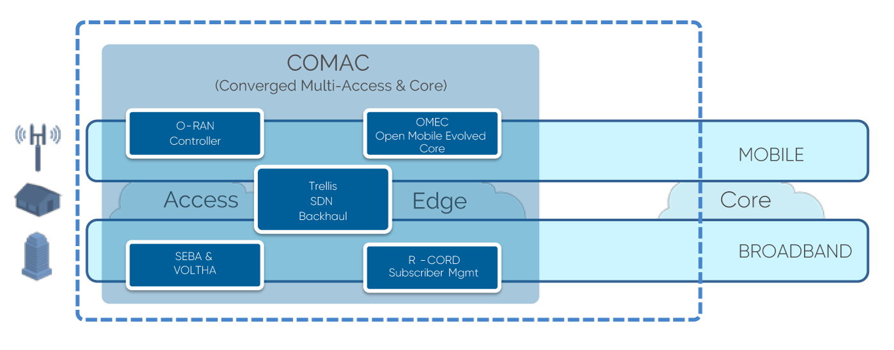

# COMAC Profile

COMAC (Converged Multi-Access and Core) is a profile meant for 5G mobile networks together with broadband access networks.

Here is brief COMAC platform:

NOTE: Among five elements in the figure, O-RAN Controller, and Broadband elements will be included at the next COMAC release.

The following pages describe how to install and configure COMAC and troubleshoot an installed COMAC PODs.

For more information, please see ONF Connect 2019 slides and videos [(here)](https://www.opennetworking.org/onf-connect-2019-resources/).
