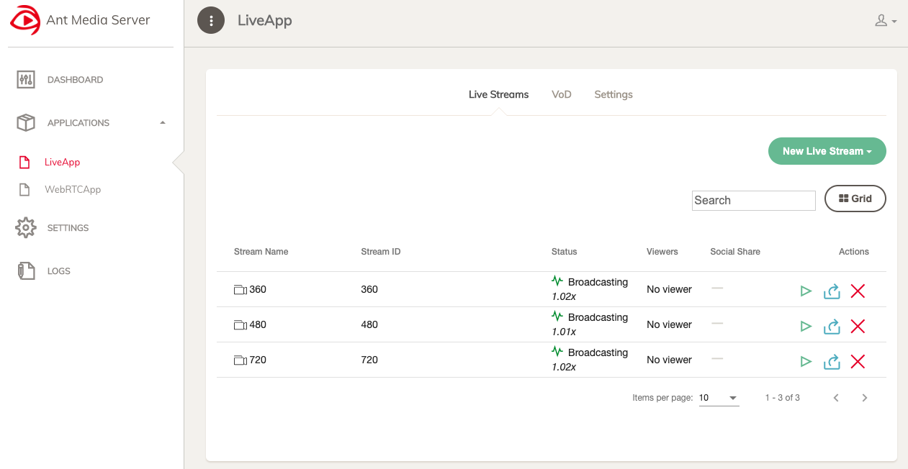

# Install CDN charts

This page shows how to install CDN Helm charts which include the CDN-Local chart and the CDN-Remote chart.

## Preliminaries

In order to deploy CDN Helm charts, there are following preliminaries:

* The Kubernetes cluster should be able to use SR-IOV CNI, since the CDN-Local Helm chart requires SR-IOV.
* Before installing CDN Helm charts, the OMEC data plane should be installed.

## Multi-cluster & single-cluster environments

The CDN in COMAC release supports both multi-cluster and single-cluster environments.

### Installing CDN Helm charts in multi-cluster environment

It assumes that there are multiple Kubernetes clusters: (i) One is an edge cluster and (ii) the others are central clusters. CDN-Local Helm chart will be deployed on the edge cluster, whereas CDN-Remote Helm chart will be installed on the central clusters.

#### 1. Add CORD Helm chart repository on edge and central clusters

```bash
helm repo add cord https://charts.opencord.org
helm repo update
```

#### 2. Deploy `CDN-Remote` in each central clusters

Go to each central cluster, and deploy CDN-Remote Helm chart with the command:

```bash
helm install -n cdn-remote cord/cdn-remote
```

#### 3. Make `cdn_var.yaml` file in the edge cluster

Next, go to the edge cluster and make `cdn_var.yaml` file which includes information of CDN-Remotes. For example, if there is two central clusters which operate a CDN-Remote for each, we can write `cdn_var.yaml` like below:

```bash
config:
  cdnRemotes:
  - name: remote-1
    ip: 10.90.0.131 # One of the central cluster node IP address
    port: 30935
    streams: # Video files in CDN-Remote
    - name: 360p
      value: 360
    - name: 480p
      value: 480
    - name: 720p
      value: 720
  - name: remote-2
    ip: 10.90.1.131 # One of the central cluster node IP address
    port: 30935
    streams: # Video files in CDN-Remote
    - name: 360p
      value: 360
    - name: 480p
      value: 480
    - name: 720p
      value: 720
```

#### 4. Deploy `CDN-Local` in the edge cluster

Next, go to the central and deploy CDN-Local Helm chart. Before the deployment, check whether `sriov-device-plugin` PODs are running or not:

```bash
kubectl get pods | grep sriov-device-plugin
```

NOTE: If the OMEC data plane was deployed before, `sriov-device-plugin` should be running in the edge cluster. In addition, the number of `sriov-device-plugin` is equal to the number of computing nodes in the edge cluster. The reason is that each computing node in the edge cluster should have one `sriov-device-plugin` POD.

If `sriov-device-plugin` POD is running on each computing node, deploy CDN-Local Helm chart with the following command:

```bash
helm install -f /path/to/cdn_var.yaml -n cdn-local cord/cdn-local
```

### Installing CDN Helm charts in single-cluster environment

This environment has a single cluster which will have both CDN-Local and CDN-Remote, simultaneously.

#### 1. Add CORD Helm chart repository on the cluster

```bash
helm repo add cord https://charts.opencord.org
helm repo update
```

#### 2. Deploy `CDN-Remote` in the cluster

Go to the cluster, and deploy CDN-Remote Helm chart with the command:

```bash
helm install -n cdn-remote cord/cdn-remote
```
#### 3. Make `cdn_var.yaml` file in the cluster

In the cluster, make `cdn_var.yaml` file which includes information of CDN-Remote. Since each cluster has a single CDN-Remote, `cdn_var.yaml` file has information of only single CDN-Remote:

```bash
config:
  cdnRemotes:
  - name: remote-1
    ip: 10.90.0.131 # One of the cluster node IP address
    port: 30935
    streams: # Video files in CDN-Remote
    - name: 360p
      value: 360
    - name: 480p
      value: 480
    - name: 720p
      value: 720
```

#### 4. Deploy `CDN-Local` in the cluster

In the cluster, make sure that `sriov-device-plugin` POD is running on each computing node with the same way described in the multi-cluster environment.

If `sriov-device-plugin` POD is running on each computing node deploy CDN-Local Helm chart with the following command:

```bash
helm install -f /path/to/cdn_var.yaml -n cdn-local cord/cdn-local
```

## Verification

### CDN-Local deployment

Once CDN-Local Helm was deployed, run the following command on the cluster which CDN-Local is running:

```bash
kubectl get pods
```

Then, there is a `nginx` POD.

```bash
NAME                                                              READY   STATUS      RESTARTS   AGE
nginx-0                                                           1/1     Running     0          100m
```

### CDN-Remote deployment

Likewise, run the following command on the cluster which CDN-Remote is running:

```bash
kubectl get pods
```

If CDN-Remote is running, there are two PODs, `ant-media` and `video-archive`.

```bash
NAME                                                              READY   STATUS      RESTARTS   AGE
ant-media-0                                                       1/1     Running     0          100m
video-archive-0                                                   3/3     Running     0          100m
```

### Ant Media UI

If CDN-Remote is running without any problem, users can access Ant Media Web UI:

```bash
http://<any computing node IP address in the cluster which has CDN-Remote>:32080
```



NOTE: Sometimes, this Web UI will response, belatedly. Then, please refresh again.

## How to play video?

In order to play video, UEs should be connected with OMEC EPC through eNodeB (eNB). Also, UEs should contain a video player application like VLC or MXPlayer.

### Play cached video files

Turn on the video player application and go to `video streaming` menu. Then, write the following URLs.

* To play 360p cached video file: rtmp://&lt;SPGW-U IP address&gt;:1935/l/360.mp4
* To play 480p cached video file: rtmp://&lt;SPGW-U IP address&gt;:1935/l/480.mp4
* To play 720p cached video file: rtmp://&lt;SPGW-U IP address&gt;:1935/l/720.mp4

NOTE: SPGW-U IP address should be 13.1.1.3 by default.

### Play remote video files

Turn on the video player application and go to `video streaming` menu. Then, write the following URLs.

* To Play 360p video file in CDN-Remote: rtmp://&lt;SPGW-U IP address&gt;:1935/r/&lt;CDN-Remote name&gt;/360
* To Play 480p video file in CDN-Remote: rtmp://&lt;SPGW-U IP address&gt;:1935/r/&lt;CDN-Remote name&gt;/480
* To Play 720p video file in CDN-Remote: rtmp://&lt;SPGW-U IP address&gt;:1935/r/&lt;CDN-Remote name&gt;/720

NOTE: SPGW-U IP address should be 13.1.1.3 by default. Also, CDN-Remote name is defined in `cdn_var.yaml` file which was used to deploy the CDN-Local Helm chart before. In the above example `cdn_var.yaml` file, one of CDN-Remote name is remote-1.
