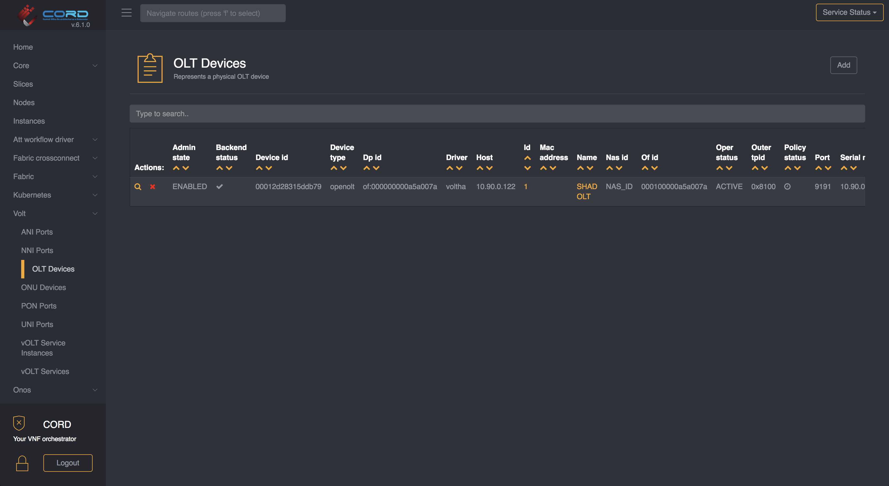
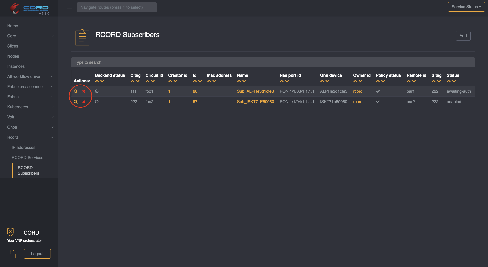

# Delete an OLT

For information on how to add an OLT, please refer to the [OLT configuration](../configure/olt.md) page.

## Remove an OLT

In order to remove the OLT it is mandatory that no active subscribers are using it.

You have two options:

* [removing the subscribers](olt-ops.md#remove-subscriber)
* [changing their state to pre-provisioned](olt-ops.md#change-subscriber-status)

Once the subscribers are gone you can navigate to `vOLT -> OLT Devices` and remove the device by clicking on the red `X` icon on the left side of the table.

### Remove subscriber

To remove a subscriber just visit `RCORD -> RCORD Subscribers` and click on the red `X` icon on the left side of the table.

